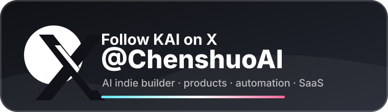
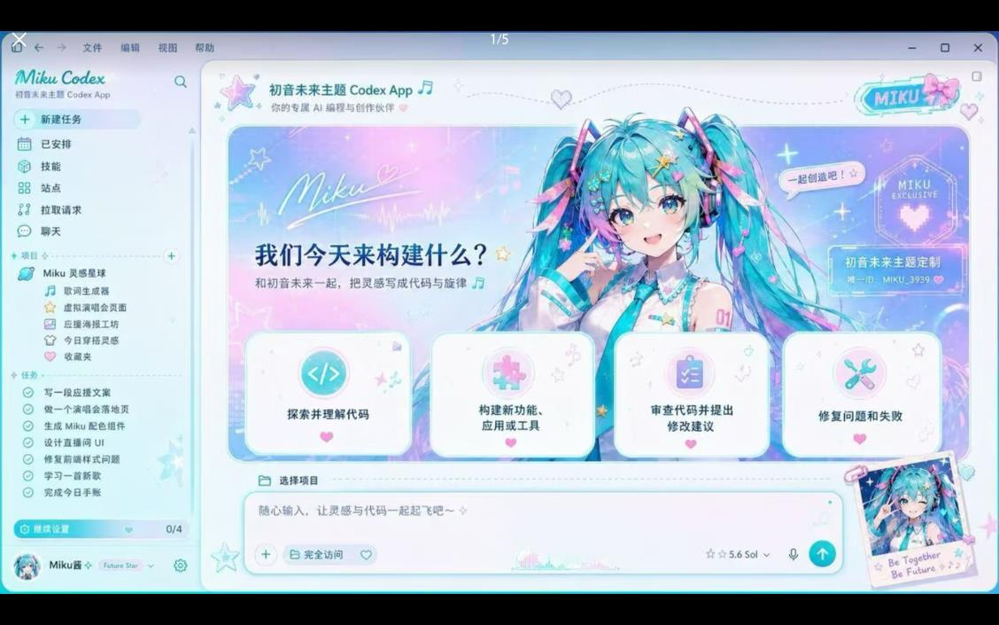

# Codex Dream Skin · X Account Edition

  <a href="./README.md">中文</a> · <strong>English</strong>

  <strong>Give Codex a face that breathes.</strong> 
  External themes for the Codex desktop app · Local CDP injection · No official package mutation

  One image, one mood · Code with atmosphere

  Unofficial. Does not modify <code>.app</code> / <code>app.asar</code> / WindowsApps.

## X Account Edition

  

  <strong>Follow KAI on X: <a href="https://x.com/ChenshuoAI">@ChenshuoAI</a></strong> 
  AI indie builder · Product validation · Automation workflows · SaaS experiments

  This edition turns the original sponsor slot into a personal X account callout for distributing a branded Codex skin.

## Gallery

One image, one mood. New previews for the X Account Edition:

   
  Miku Codex Theme

   
  Arina Hashimoto Custom Skin

   
  God of Wealth Codex Theme

   
  Jackson Yee Custom Skin

   
  ENFP Universe Theme

## What It Does

- **Real UI**: Sidebar, cards, project picker, and input stay native. This is not a fake full-window screenshot.
- **Swappable art**: Drop in an image you like and it becomes your theme.
- **Restorable**: One-click restore to the stock look.
- **Safer path**: Local-loopback CDP injection only. No official binary or signature changes.

## Quick Start

Platform scripts are ready:

| Platform | Dir | Entry |
| --- | --- | --- |
| Apple Silicon / Intel Mac | [`macos/`](./macos/) | Double-click `Install Codex Dream Skin.command` |
| Windows | [`windows/`](./windows/) | `scripts/install-dream-skin.ps1` → `start-dream-skin.ps1` |

More detail:

- Mac: [`macos/README.md`](./macos/README.md)
- Windows: [`windows/SKILL.md`](./windows/SKILL.md)
- Paths: [`docs/platforms.md`](./docs/platforms.md)
- Project notes: [`docs/PROJECT.md`](./docs/PROJECT.md)

## Feedback & Contributions

- **Issues:** Use the [issue templates](./.github/ISSUE_TEMPLATE/) and try Verify / Restore self-checks first.
- **PRs:** Follow the [PR template](./.github/pull_request_template.md), describe the change, and tick the self-checks you ran.

## Safety

- CDP binds `127.0.0.1` only.
- Does not touch the official install directory or code signature.
- **Never** rewrites API Key / Base URL; relay and theme stay separate.

## License

- See [`macos/LICENSE`](./macos/LICENSE) (MIT) and [`macos/NOTICE.md`](./macos/NOTICE.md).
- Unofficial; Codex and related rights belong to their owners.
- People / IP art in previews is illustrative only. Clear rights before commercial redistribution.

---

Star it, pick a look, and make Codex yours for today.
