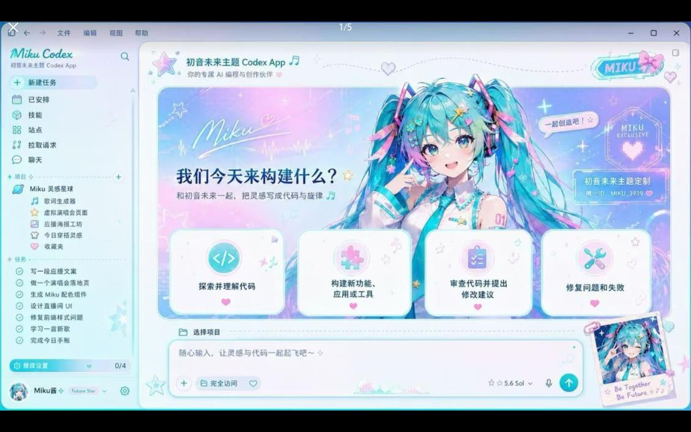

> **English:** An independent theming tool for Codex Desktop that injects local visual themes through CDP without modifying the official app package.

# Codex Dream Skin · X Account 

  <strong>中文</strong> · <a href="./README.en.md">English</a>

  <strong>给 Codex 桌面端换一张会呼吸的脸。</strong> 
  外部主题 / 换肤工具 · 本地 CDP 注入 · 不修改官方安装包

  一张图，一种心情 · 写代码，也要有氛围感

  非 OpenAI 官方产品。不修改 <code>.app</code> / <code>app.asar</code> / WindowsApps。

## X 账号版本

  

  <strong>关注陈硕 KAI 的 X：<a href="https://x.com/ChenshuoAI">@ChenshuoAI</a></strong> 
  AI 独立创业 · 产品验证 · 自动化工作流 · SaaS 实战

  这个版本把原项目的赞助展示位改成 X 账号引导位，适合用来分发个人品牌版 Codex 皮肤。

## 效果预览

一张图，一种心情。下面都是新的 X 账号版本案例图：

   
  初音未来主题 Codex

   
  桥本有菜专属定制皮肤

   
  财神打工版 Codex

   
  易烊千玺专属定制皮肤

   
  ENFP 小宇宙主题

## 它能做什么

- **真 UI 可交互**：侧栏、建议卡、项目选择、输入框都是原生控件，不是整窗假截图。
- **可换图**：换一张喜欢的图，就能变成你的主题。
- **可恢复**：一键还原官方外观。
- **相对安全**：本机回环 CDP 注入，不改官方二进制与签名。

## 快速开始

仓库内按平台放了现成脚本：

| 平台 | 目录 | 入口 |
| --- | --- | --- |
| Apple Silicon / Intel Mac | [`macos/`](./macos/) | 双击 `Install Codex Dream Skin.command` |
| Windows | [`windows/`](./windows/) | `scripts/install-dream-skin.ps1` → `start-dream-skin.ps1` |

更详细的说明：

- Mac：[`macos/README.md`](./macos/README.md)
- Windows：[`windows/SKILL.md`](./windows/SKILL.md)
- 路径对照：[`docs/platforms.md`](./docs/platforms.md)
- 项目记录：[`docs/PROJECT.md`](./docs/PROJECT.md)

## 反馈与贡献

- **Issue：** 请用 [Issue 模板](./.github/ISSUE_TEMPLATE/)；提交前建议先跑 Verify / Restore 自检。
- **PR：** 请按 [PR 模板](./.github/pull_request_template.md) 写清改动，并勾选对应自测。

## 安全边界

- CDP 只绑定 `127.0.0.1`。
- 不修改官方安装目录与代码签名。
- **不会**自动改写 API Key / Base URL；中转与换肤分开。

## 许可与声明

- 见 [`macos/LICENSE`](./macos/LICENSE)（MIT）与 [`macos/NOTICE.md`](./macos/NOTICE.md)。
- 非 OpenAI 官方产品；Codex 及相关权利归其权利人。
- 效果图中的人物 / IP 形象仅作主题示意；商用或公开再分发请自行确认肖像权与商标授权。

---

Star 一下，然后挑一张图，把你的 Codex 变成今天想要的样子。
